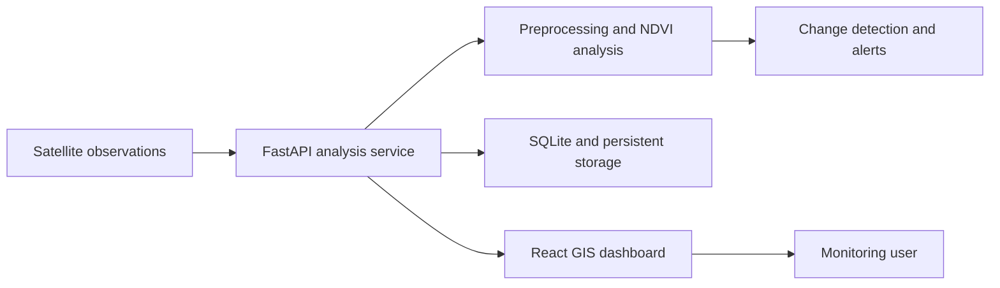

# ForestWatch

## Architecture



> Satellite-based forest monitoring and vegetation-change analysis.

[](https://forest-watch-mu.vercel.app/)
[](https://www.python.org/)
[](https://fastapi.tiangolo.com/)
[](LICENSE)

ForestWatch helps users compare dated satellite observations, evaluate vegetation-health indicators, surface potential change, and prepare monitoring insights. It combines a React GIS dashboard with a FastAPI service and a local, dataset-driven analysis workflow.

| | |
| --- | --- |
| **Live app** | [Open ForestWatch](https://forest-watch-mu.vercel.app/) |
| **Dashboard** | React + Vite |
| **Analysis API** | FastAPI |
| **Primary inputs** | Dated Sentinel-1 / Sentinel-2 imagery |

## Contents

- [Live dashboard](#live-dashboard)
- [What it does](#what-it-does)
- [Architecture](#architecture)
- [How it works](#how-it-works)
- [Run locally](#run-locally)
- [Configuration](#configuration)
- [API at a glance](#api-at-a-glance)
- [Deployment](#deployment)

## Live dashboard

Explore the deployed app: **[forest-watch-mu.vercel.app](https://forest-watch-mu.vercel.app/)**

<p align="center">
  
</p>

## What it does

- Compares earlier and later satellite observations.
- Calculates vegetation-health and NDVI-based change indicators.
- Displays stable, decrease, and increase areas in an interactive dashboard.
- Shows true-colour imagery alongside change summaries.
- Supports alerts, reporting, prediction experiments, and image uploads.
- Keeps preprocessing non-destructive and records a processing manifest.

## How it works

```text
Satellite observations
        │
        ▼
Dataset scanning and preprocessing
        │
        ▼
NDVI and image analysis
        │
        ├──► Change detection
        ├──► Health alerts
        ├──► Historical prediction
        └──► Reports
        │
        ▼
React GIS dashboard + FastAPI API
```

## Tech stack

| Area | Tools |
| --- | --- |
| Dashboard | React, Vite |
| API and interactive workspace | FastAPI, Uvicorn, Gradio |
| Geospatial analysis | Rasterio, NumPy, Pillow, Pandas |
| Data and persistence | SQLAlchemy, SQLite |
| Visualisation | Plotly, Matplotlib |
| Modelling | Scikit-learn, ONNX Runtime (packaged YOLOv8n model) |
| Deployment | Vercel dashboard, Python-compatible API host such as Render |

## Project structure

```text
ForestWatch/
├── frontend/           # React/Vite GIS dashboard
├── forestwatch/        # FastAPI service and analysis modules
├── tests/              # Test suite
├── requirements.txt    # Python dependencies
├── docker-compose.yml  # Local container setup
└── .env.example        # Environment-variable reference
```

## Run locally

### Prerequisites

- Python 3.10 or newer
- Node.js 20 or newer
- A local satellite dataset (optional for exploring the interface, required for meaningful analysis)

### 1. Clone and configure Python

```bash
git clone https://github.com/AryaLolusare2712/ForestWatch.git
cd ForestWatch
python -m venv .venv
```

Activate the environment:

```powershell
# Windows PowerShell
.\.venv\Scripts\Activate.ps1
```

```bash
# macOS / Linux
source .venv/bin/activate
```

Install the API dependencies:

```bash
pip install -r requirements.txt
```

### 2. Create local configuration

Copy `.env.example` to `.env`, then adjust the paths and thresholds for your machine.

```env
FORESTWATCH_DATASET=dataset
FORESTWATCH_OUTPUT=data
FORESTWATCH_PROJECT_DATA=dataset
FORESTWATCH_LOW_NDVI=0.3
FORESTWATCH_HEALTHY_NDVI=0.6
FORESTWATCH_DECREASE=-0.15
```

Never commit `.env` files, SMTP passwords, or private dataset paths.

### 3. Start the API

```bash
python -m uvicorn forestwatch.api:app --reload
```

The API documentation is available at [http://127.0.0.1:8000/docs](http://127.0.0.1:8000/docs).

### 4. Start the dashboard

In another terminal:

```bash
cd frontend
npm install
npm run dev
```

Open the Vite URL shown in the terminal—normally [http://127.0.0.1:5173](http://127.0.0.1:5173).

### Optional: run the Gradio workspace

```bash
python -m forestwatch.gradio_app
```

## Configuration

| Variable | Purpose | Example |
| --- | --- | --- |
| `FORESTWATCH_DATASET` | Root directory for source observations | `dataset` |
| `FORESTWATCH_OUTPUT` | Directory for generated outputs | `data` |
| `FORESTWATCH_DECREASE` | NDVI change threshold used for decrease detection | `-0.15` |
| `FORESTWATCH_ALLOWED_ORIGINS` | Comma-separated frontend origins permitted to call the API | `http://localhost:5173` |
| `FORESTWATCH_SUPABASE_*` | Optional private storage integration | See `.env.example` |
| `FORESTWATCH_SMTP_*` | Optional email-alert configuration | See `.env.example` |

Copy `.env.example` rather than creating values from scratch; it documents every supported option.

## API at a glance

With the API running, interactive documentation is available at [`/docs`](http://127.0.0.1:8000/docs).

| Endpoint group | Examples | Purpose |
| --- | --- | --- |
| Health and inventory | `/api/health`, `/api/dataset/inventory` | Verify service status and discover available data |
| GIS and imagery | `/api/gis/dashboard`, `/api/gis/true-colour/{date}` | Supply the dashboard with selected-period imagery and metrics |
| Analysis | `/api/ndvi/*`, `/api/change-detection/*` | Retrieve NDVI observations and change results |
| Alerts and reports | `/api/alerts`, `/api/reports/{period}` | Review health alerts and create monitoring reports |
| Prediction | `/api/predictions/*` | Train and retrieve experimental forecasts |

## Dataset notes

ForestWatch works with dated Sentinel-1 and Sentinel-2 observations. Organise source material by date so the dashboard can compare periods consistently.

```text
dataset/
├── Sentinel-1/
│   ├── VV/
│   └── VH/
└── Sentinel-2/
    ├── NDVI/
    └── TrueColor/
```

Use the dashboard's preprocessing workflow before analysis. It validates readable files, normalises imagery, and preserves the source data.

## Deployment

The reference deployment separates the dashboard and API:

1. Deploy the FastAPI service to Render (or another Python host).
2. Attach persistent storage for the dataset, uploads, reports, and SQLite data.
3. Set `FORESTWATCH_ALLOWED_ORIGINS` to the dashboard URL.
4. Deploy `frontend/` to Vercel and set `VITE_FORESTWATCH_API` to the API URL.

> **Security note:** keep service-role keys and SMTP credentials on the backend host only. They must never be exposed in the Vite frontend or committed to Git.

## Responsible interpretation

ForestWatch provides monitoring signals, not a conclusive finding of deforestation. NDVI and image differences can be affected by seasonality, cloud cover, sensor differences, moisture, and image quality. Validate potential degradation with appropriate georeferenced data and field assessment before making management or conservation decisions.

## Contributing

Contributions and ideas are welcome.

1. Fork the repository.
2. Create a branch: `git checkout -b feature/my-improvement`
3. Commit your changes and open a pull request.

## License

Released under the [MIT License](LICENSE).
